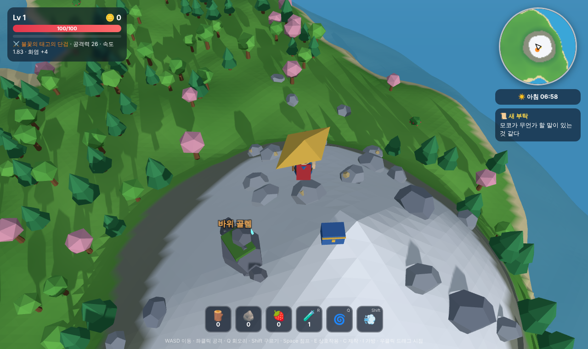

# 떠돌이 섬 (Wanderer's Isle)

탐험 · 핵앤슬래시 전투/파밍 · 생존 제작 · 마을살이를 섞은 브라우저 3D 게임 프로토타입입니다.
Three.js만 사용하고 빌드 과정이 없습니다.



## 실행

ES 모듈이라 파일을 더블클릭하면 실행되지 않습니다. 로컬 서버로 여세요.

```bash
cd game
python3 -m http.server 8000
# 브라우저에서 http://localhost:8000
```

## 조작

| 키 | 동작 |
|---|---|
| WASD | 이동 |
| 좌클릭 | 마우스 방향으로 공격 (나무·바위 채집도 공격으로) |
| Q | 회오리 베기 (범위 공격, 6초 쿨타임) |
| Shift | 구르기 (무적) |
| Space | 점프 / 공중에서 누르고 있으면 활공 (날개 획득 후) |
| E | 대화 · 상자 열기 · 열매 따기 |
| R | 물약 사용 (건축 중에는 회전) |
| C / I | 제작 / 가방 |
| 우클릭 드래그 · 휠 | 시점 회전 · 줌 |

## 시스템

- **전투 & 파밍**: 슬라임, 랩터, 정예 몬스터, 보스(바위 골렘). 일반/마법/희귀/전설 등급 무기가 랜덤 접두사(흡혈, 화염, 날렵한…)와 함께 떨어집니다.
- **생존 & 제작**: 나무·돌·열매를 모아 모닥불(회복 + 몬스터 접근 차단), 울타리, 화분, 가로등, 오두막(부활 지점)을 짓습니다.
- **마을살이**: 주민 모코와 피오의 부탁 5개, 상점(물약 구매 / 무기 판매), 마을 꾸미기.
- **탐험 & 퍼즐**: 낮과 밤(밤에는 몬스터 증가), 숨겨진 보물상자, 유적의 수정 퍼즐을 풀면 활공 날개를 얻습니다.
- 진행 상황은 브라우저 localStorage에 10초마다 자동 저장됩니다.

## 파일 구조

- `index.html`: HUD와 UI 마크업
- `style.css`: UI 스타일
- `main.js`: 게임 전체 (월드 생성, 전투, 루트, 제작, NPC, 퀘스트, 저장)
